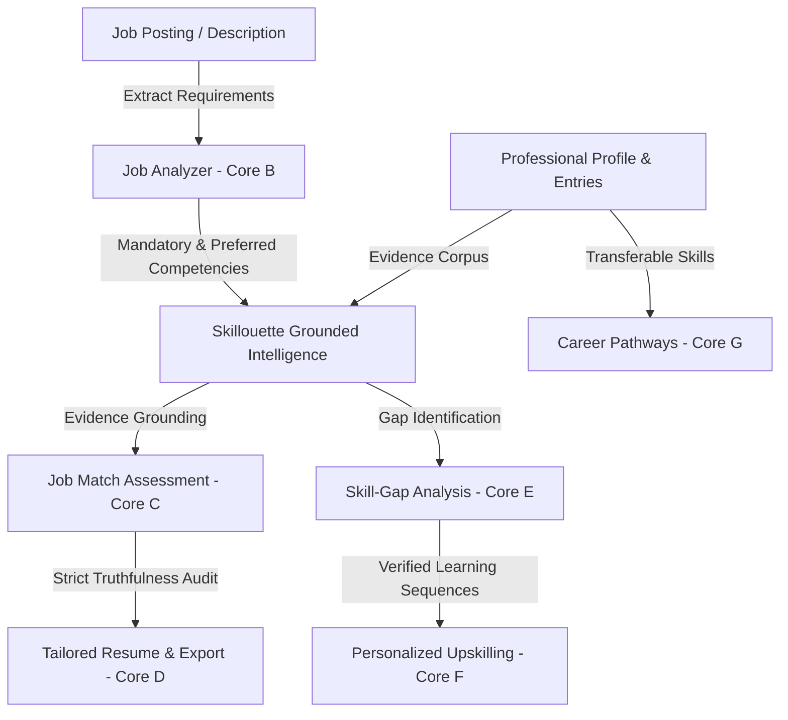

# Skillouette 🚀
> **AI-Powered Career & Workforce Readiness Platform**  
> *Help users present their existing qualifications effectively while identifying what they need to learn next. Never fabricate qualifications to make a user appear more employable.*

[](https://github.com/Ryxx-XD/Skillouette/actions)
[](https://www.typescriptlang.org/)
[](https://reactjs.org/)
[](https://pages.cloudflare.com/)
[](https://supabase.com/)

---

## 1. Product Vision & Architecture

Skillouette bridges the gap between what engineers have proven they can build and what target employers demand. Built on a strict **Anti-Hallucination Grounded Intelligence** model, Skillouette strictly separates documented profile facts from AI-assisted phrasing and refuses to silently convert desired competencies into false resume claims.



---

## 2. Core Platform Capabilities

### 🛡️ Core Feature A — Professional Profile & Entries
- Complete management of technical skills, categorized sub-competencies, work experience, education, projects, metrics, and references.
- Distinguishes between user claims and verified credentials.
- Freeform **AI Brain Dump capture** parses raw unstructured notes and maps them into dynamic profile sections.

### 🔍 Core Feature B — Job Description Analysis
- Deep requirements extraction from arbitrary job postings.
- Strictly parses and isolates **Mandatory (Required)** versus **Preferred (Bonus)** competencies.
- Extracts educational requirements, quantified experience levels, certifications, and technical keywords.
- Detects ambiguous or missing employer specifications.

### 🎯 Core Feature C — AI Job Matching
- Evaluates candidate profile entries against target specifications using transparent weighted scoring.
- Documents exact calculation: Mandatory requirements (1.5x weight) + Preferred (1.0x) with calibrated heuristic scoring.
- Links matching evidence directly to specific profile entries.

### 📄 Core Feature D — Truthful Resume & CV Generation
- Generates role-tailored summaries and formats resumes strictly using candidate's documented experience.
- **Anti-Fabrication Guardrail**: Automatically audits generated content and rejects ungrounded claims.
- Exports to print-ready **PDF** and Microsoft Word **DOCX** formats.

### 📊 Core Feature E — Skill-Gap Analysis
- Categorizes all requirements into:
  - `Demonstrated Match`
  - `Partially Demonstrated`
  - `Not Demonstrated in Profile`
  - `Requires Clarification`
- Provides actionable improvement steps for each gap without treating absence of documentation as proof of incompetence.

### 📚 Core Feature F — Personalized Upskilling
- Produces step-by-step learning sequences with practical exercises and portfolio project ideas.
- Curates **verified, reliable resources** (official FreeRTOS, ROS 2, STM32, Python, and ISO C++ documentation). Never fabricates fake URLs.
- In-app tracker monitors skill status: `Not Started` → `In Progress` → `Completed`.

### 🧭 Core Feature G — Career Pathways
- Identifies realistic adjacent roles and alternative trajectories based on documented transferable competencies.
- Highlights transferable strengths, necessary bridging qualifications, and realistic roadmaps with full industry disclaimers.

---

## 3. Technology Stack & Infrastructure

- **Frontend**: React 18, TypeScript, Vite, Vanilla CSS with custom cybernetic design system and Lucide icons.
- **Backend**: Node.js, Express, TypeScript (`tsx`), `docx`.
- **Hosting**: Cloudflare Pages (`wrangler.toml`, `_redirects`, `_headers`).
- **Database**: Supabase PostgreSQL with version-controlled migrations and Row Level Security (RLS) policies. Includes seamless local resilient file fallback for offline/development environments.
- **AI Engine**: Google Gemini 1.5 Flash / OpenAI GPT-4o with grounded rule-based heuristic fallbacks when keys are absent.
- **Observability**: Structured telemetry tracking request counters, latencies, AI calls, and automated PII redaction.
- **Source Control & CI/CD**: GitHub Actions workflow running tests and production builds on push/PR.

---

## 4. Environment Configuration

Copy `.env.example` to `.env` in the root directory:

```bash
cp .env.example .env
```

| Variable | Description | Required |
| :--- | :--- | :--- |
| `PORT` | Local backend port (default: 3001) | No |
| `NODE_ENV` | Runtime environment (`development` / `production`) | No |
| `SUPABASE_URL` | Supabase project URL | Optional (Local fallback active if omitted) |
| `SUPABASE_ANON_KEY` | Public client Supabase anon key | Optional |
| `SUPABASE_SERVICE_ROLE_KEY` | Privileged server-only Supabase service key | Optional (Never expose to browser) |
| `GEMINI_API_KEY` | Google Gemini API key | Optional (Rule-based heuristic runs if omitted) |
| `OPENAI_API_KEY` | OpenAI API key | Optional |

---

## 5. Getting Started & Development

### Installation

```bash
# Install root, client, and server dependencies
npm install
npm --prefix client install
npm --prefix server install
```

### Running Locally

```bash
# Concurrently start backend API and frontend Vite dev server
npm run dev
```
- Client running at: `http://localhost:5173`
- Server running at: `http://localhost:3001`

### Running Automated Test Suite

```bash
npm run test
```

### Production Build

```bash
npm run build
```

---

## 6. Health Checks & Observability Endpoints

Skillouette provides built-in health monitoring and structured operational telemetry:

- **Liveness Endpoint**: `GET /health`  
  Returns `{ status: "healthy", uptime_seconds: ... }`.
- **Readiness Endpoint**: `GET /health/ready`  
  Checks database connectivity (Supabase REST or local resilient storage) and AI provider status with HTTP 200 or 503.
- **Telemetry & Audit Endpoint**: `GET /api/telemetry/stats`  
  Returns aggregate request volume, 2xx/4xx/5xx counts, AI provider latencies, and sanitized operational event logs with PII (emails, keys, phone numbers) redacted.

---

## 7. Supabase Database Migration

SQL migrations are located in `supabase/migrations/20261018000001_initial_skillouette_schema.sql`.

To apply to your Supabase project:
1. Link your Supabase CLI project or open the **SQL Editor** on your Supabase Dashboard.
2. Execute `20261018000001_initial_skillouette_schema.sql`.
3. Row Level Security (RLS) is automatically enabled on all 11 tables (`profiles`, `sections`, `subsections`, `entries`, `job_postings`, `match_assessments`, `skill_gaps`, `upskilling_recommendations`, `career_pathways`, `audit_logs`).

---

## 8. Cloudflare Pages Deployment

Deploying to Cloudflare Pages is configured via `wrangler.toml`:

```bash
# Build production bundle
npm run build

# Deploy via Wrangler CLI
npx wrangler pages deploy client/dist --project-name=skillouette
```

Alternatively, connect the GitHub repository `https://github.com/Ryxx-XD/Skillouette.git` directly to Cloudflare Pages:
- **Build command**: `npm run build`
- **Build output directory**: `client/dist`
- **Root directory**: `/`

---

## 9. Security & Privacy

1. **Anti-Hallucination Verification**: Resume summaries are subjected to truthfulness audits before being displayed or exported.
2. **Untrusted Data Isolation**: Job postings and user brain dumps are treated as untrusted input and sanitized against prompt injections.
3. **Server-Side Key Isolation**: Privileged service-role database keys and LLM API keys are strictly kept server-side.
4. **PII Redaction**: Telemetry engine strips emails, phone numbers, and API tokens before logging.
